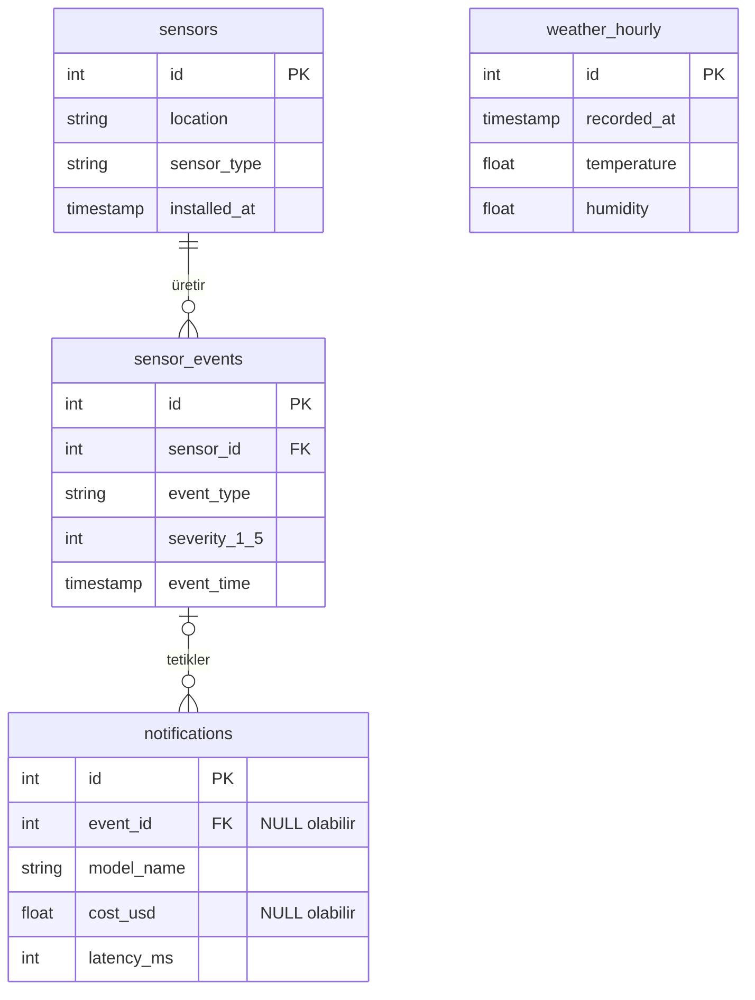

* **Ad soyad:** Esin Gülsün Akdemir
* **Öğrenci numarası:** 202607131004
# Kura #5 — Akıllı Şehir × IoT Sensör Ağı × LLM Çağrı Maliyeti

Bu klasör, verilen proje senaryosunun çalıştırılabilir eğitim/prototip paketidir. PostgreSQL şeması, CSV verileri, Hafta 5 sorguları, veri kalite kontrolleri, Python analiz çıktıları ve dönem sonu model karşılaştırma tablosu dahildir.

## Önce önemli veri notu

Bu paketteki **720 sensör olayı ve 818 bildirim sentetik eğitim verisidir**. Belediye sisteminden alınmış gerçek kayıt değildir. Model maliyetleri de örnek amaçlı simüle edilmiştir; herhangi bir sağlayıcının güncel API fiyatı olarak kullanılmamalıdır.

`weather_hourly.csv` dosyası da hazır paket içinde internet erişimi gerektirmeyen sentetik yedek veridir. Gerçek İstanbul saatlik meteoroloji verisiyle değiştirmek için:

```bash
pip install -r requirements.txt
python src/fetch_open_meteo.py
```

Bu komut Open-Meteo Historical Weather API'den 1–31 Ocak 2025, İstanbul koordinatları (41.0082, 28.9784), `Europe/Istanbul` zaman dilimi için sıcaklık, bağıl nem, yağış ve rüzgâr verilerini çekmeyi dener. Başarılı olursa `data/weather_hourly.csv` üzerine gerçek API verisini yazar ve kaynak bilgisini `data/open_meteo_metadata.json` dosyasına kaydeder. Bağlantı yoksa mevcut sentetik dosyayı korur.

## Klasör yapısı

```text
vize-202607131004/
├── data/
│   ├── sensors.csv
│   ├── sensor_events.csv
│   ├── notifications.csv
│   ├── weather_hourly.csv
│   ├── data_profile.json
│   └── data_dictionary.csv
├── sql/
│   ├── 01_schema_and_load.sql
│   ├── 02_week5_queries.sql
│   └── 03_ai_extension.sql
├── src/
│   ├── generate_data.py
│   ├── fetch_open_meteo.py
│   ├── analyze.py
│   └── convert_beijing_kaggle.py
├── reports/
│   ├── rapor.md
│   ├── analysis_summary.json
│   ├── q1_event_type_cost.csv
│   ├── q2_orphan_notification_share.csv
│   ├── q3_event_type_over_one_usd.csv
│   ├── q4_severity_latency_crosstab.csv
│   ├── q5_hourly_intensity.csv
│   ├── model_comparison_global.csv
│   └── model_comparison_by_event_severity.csv
└── AI_notification_prompt.md
```

## Hızlı başlatma

### 1. Veriyi yeniden üret ve analiz et

Proje kök klasöründe:

```bash
python src/generate_data.py
python src/analyze.py
```

Rastgelelik tohumu sabittir (`20261105`); aynı Python/pandas davranışı altında aynı eğitim verisi oluşur. `generate_data.py` bilerek eksik `event_id`, eksik maliyet ve negatif gecikme satırları ekler.

### 2. PostgreSQL veritabanını oluştur

```bash
createdb kura5_city
psql -d kura5_city -f sql/01_schema_and_load.sql
```

Bu komutu proje kök klasöründeyken çalıştır. `psql` yüklü değilse pgAdmin'de `kura5_city` veritabanı oluştur; `01_schema_and_load.sql` içindeki `CREATE TABLE` ifadelerini çalıştır ve dört CSV dosyasını ilgili tablolara Import/Export aracıyla aktar.

### 3. Hafta 5 sorgularını çalıştır

```bash
psql -d kura5_city -f sql/02_week5_queries.sql
```

### 4. Dönem sonu ilişki tablosunu üret

```bash
psql -d kura5_city -f sql/03_ai_extension.sql
psql -d kura5_city -f sql/04_weather_context.sql
```

## Kaynak veri yaklaşımı

- **Kaggle:** Saatlik hava kalitesi sensör yapısı için Beijing Multi-Site Air-Quality veri seti incelendi. Bu veri 12 istasyondaki saatlik kirletici ölçümlerini ve meteorolojik alanları içerir; ancak Pekin'e ve 2013–2017 dönemine aittir. İstanbul belediye verisi gibi gösterilmemelidir. Kaggle dosyalarını `data/kaggle_beijing/` klasörüne çıkartıp `python src/convert_beijing_kaggle.py` komutuyla ayrı bir `air_quality_observations.csv` dosyasına dönüştürebilirsin.
  İndirme (Kaggle hesabı ve API token'ı gerekir):
  ```bash
  pip install kaggle
  kaggle datasets download -d sid321axn/beijing-multisite-airquality-data-set -p data/kaggle_beijing --unzip
  python src/convert_beijing_kaggle.py
  ```
- **Open-Meteo:** Gerçek İstanbul hava durumu bağlamı için API indirme betiği eklendi. Hazır paketteki `weather_hourly.csv` API'den indirilmiş değildir; gerçek indirme yapılana kadar sentetik yedek olarak işaretlenir.
- **Hugging Face:** DailyDialog gibi diyalog veri setleri, konuşma akışı ve iletişim tonu için bağlam sağlayabilir. Bunlar belediye uyarı metinleri değildir. Projede kullanılacak Türkçe bildirim örnekleri `AI_notification_prompt.md` içinde ayrıca ve sentetik olarak yazılmıştır.

## Önemli yorumlama kuralları

1. `event_id IS NULL` olan bildirimler ilişkilendirilemeyen/olaysız kayıtlardır; olay türü maliyet analizine katılamazlar.
2. `latency_ms < 0` olan kayıtlar silinmez. Veri kalite kartında sayılır ve saat senkronizasyonu problemi olarak işaretlenir. Gecikme korelasyonu ve model gecikme karşılaştırmasında geçerli ölçüm kabul edilmez.
3. `cost_usd IS NULL` kayıtlar sıfır maliyet anlamına gelmez. `SUM` ve `AVG` NULL değerleri görmezden gelir; eksik kayıt sayısı ayrıca raporlanmalıdır.
4. Şiddet ve gecikme korelasyonu ilişki gösterir; tek başına nedensellik kanıtlamaz.
5. Model karşılaştırmasında yalnızca global ortalamaya bakma. Aynı `event_type` ve `severity_1_5` grubunda karşılaştırma yapmak daha adildir.

Ayrıntılı açıklama ve sonuçlar: `reports/rapor.md`.


## Veri Modeli

### 2.1 Güncel ERD



| İlişki | Kardinalite | Katılım |
| :--- | :--- | :--- |
| sensors – sensor_events | 1-N | Olay tarafında sensör zorunlu, sensör tarafında olay isteğe bağlı |
| sensor_events – notifications | 1-N | Bildirim tarafında olay isteğe bağlı (`event_id` NULL olabilir), olay tarafında bildirim isteğe bağlı |

**İlişki açıklamaları:**

* Bir sensör, en az 0, en çok çok sayıda olay kaydına sahiptir; bir olay kaydı, tam olarak bir sensöre aittir.
* Bir olay kaydı, en az 0, en çok çok sayıda bildirime sahiptir; bir bildirim, en fazla bir olay kaydına aittir (`event_id` NULL olabilir).
* `weather_hourly`, şehir geneli saatlik hava verisi olduğu için FK ile bir tabloya bağlı değildir; olay zamanının saatiyle mantıksal olarak eşleştirilir.

### 2.2 Normalizasyon Notu

| Tablo | Neden ayrıldı / ayrılmadı | Form | Projeden örnek |
| :--- | :--- | :--- | :--- |
| sensor_events | Her olay ayrı satır, hücrelerde liste yok | 1NF | Bir sensörün olayları tek hücrede "1,2,3" diye tutulmadı; her olay kendi `id`'sine sahip bir satır |
| notifications | Tüm sütunlar tek sütunlu PK olan `id`'nin tamamına bağlı; kısmi bağımlılık oluşamaz | 2NF | `model_name`, `cost_usd`, `latency_ms` yalnızca ilgili bildirim `id`'sini belirler |
| sensors | `location` ve `sensor_type`, `sensor_id`'yi belirler; olay `id`'sini belirlemez. Olay tablosunda tutulsaydı geçişli bağımlılık (olay → sensör → konum) ve tekrar oluşurdu | 3NF | Konum bilgisi her olayda tekrarlanmadan yalnızca `sensors` tablosunda tutuluyor |
| notifications (`model_name`) | Ayrı `models` tablosuna ayrılmadı: model adının belirlediği, bildirimden bağımsız başka bir sütun yok | 3NF | `model_name` doğrudan `id`'ye bağlı, geçişli bağımlılık yok |

### 2.3 İki JOIN Sorusu

**Soru 1 (INNER JOIN):** "Olaya bağlanabilen her bildirimin olay türü ve şiddeti nedir?"

* Birleşme: `notifications n` ve `sensor_events e` tabloları `n.event_id = e.id` üzerinden.
* JOIN türü: `INNER JOIN`. Olayı olmayan (`event_id` NULL) bildirimlerin olay türü ve şiddeti olamaz; yalnızca iki tarafta da eşleşen satırlar isteniyor.

**Soru 2 (LEFT JOIN, eşleşmeyenleri bulma):** "Hiç bildirimi üretilmemiş olaylar hangileri?"

* Birleşme: `sensor_events e` ve `notifications n` tabloları `e.id = n.event_id` üzerinden.
* JOIN türü: `LEFT JOIN` ve `WHERE n.id IS NULL`. Tüm olaylar listelenmeli; bildirimi olmayanların `n` tarafı NULL gelir, eşleşmeyen kayıtlar böylece bulunur. `INNER JOIN` bu olayları listeden düşürürdü.
