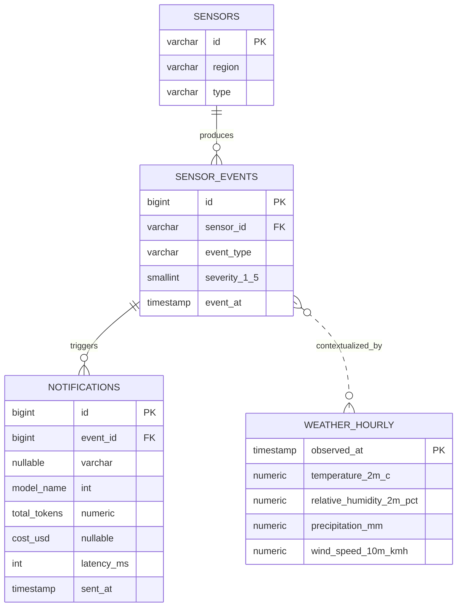

# Kura #5 Proje Raporu

## 1. Projenin amacı

Bir belediyenin akıllı şehir sensörlerinden gelen olaylara LLM ile otomatik vatandaş bildirimi ürettiği varsayılmıştır. Her bildirimin token miktarı, maliyeti ve gecikmesi takip edilir. Projenin ana soruları:

1. Hangi sensör olayı türü toplam LLM bildirim maliyetini en çok artırıyor?
2. Olay şiddeti yükseldikçe bildirim gecikmesi artıyor mu?

## 2. Veri ve kapsam

Bu teslim paketinde 12 sensör, 720 sensör olayı, 824 bildirim ve 744 saatlik hava bağlamı satırı bulunur. Sensör olayı ve bildirim kayıtları **sentetik eğitim verisidir**; belediye sisteminden veya canlı LLM servisinden alınmış değildir. Maliyet oranları da SQL'deki `HAVING SUM(cost_usd) > 1` sorgusunun anlamlı sonuç üretmesi için simüle edilmiştir.

Şehir bağlamı İstanbul kabul edilmiştir. Olay/bildirim tarihleri Ocak 2025'e yayılmıştır. `weather_hourly.csv` hazır halde sentetik yedek veri içerir. Gerçek Open-Meteo verisi için `src/fetch_open_meteo.py` çalıştırılmalıdır. Gerçek API indirilmeden bu dosya Open-Meteo ölçümü gibi raporlanmamalıdır.

### Tablo ilişkileri



`notifications.event_id` NULL olabilir. Bu alanın NULL olması, bildirimin bir sensör olayına bağlanamadığını gösterir. Hava durumu tablosu ayrı tutulur; `event_at` saatine göre en yakın saatlik meteoroloji gözlemiyle ilişkilendirilmesi mümkündür.

## 3. Nasıl oluşturdum?

1. **Şemayı kurdum.** `sensors`, `sensor_events`, `notifications` tablolarını verilen aday tablolara göre oluşturdum. Saatlik meteoroloji bağlamı için `weather_hourly` tablosunu ekledim.
2. **Veriyi hazırladım.** 12 sensör ve 720 olay ürettim. Olay türleri hava kalitesi, trafik, gürültü, taşkın, sıcaklık stresi ve atık taşmasıdır. Olayların şiddeti 1–5 arasındadır.
3. **Bildirimleri olaylara bağladım.** Çoğu olaya bir bildirim, bazılarına takip bildirimi oluşturdum. Her bildirimde model profili, token sayısı, maliyet, gecikme ve gönderim zamanı bulunur.
4. **Hafta 4 veri sorunlarını kontrollü ekledim.** 18 bildirimin `event_id` alanı boş, 30 bildirimin maliyeti boş, 12 bildirimin gecikmesi negatiftir. Bu kayıtlar analizden silinmedi.
5. **Hafta 5 sorgularını yazdım.** `GROUP BY`, `SUM`, `HAVING`, `CASE WHEN` ve `EXTRACT(HOUR ...)` kullanıldı. Ayrıca şiddet-gecikme korelasyonu hesaplandı.
6. **Dönem sonu uzantısını ekledim.** Olay türü ve model bazında maliyet/performans özetini `event_notification_cost_relation` tablosuna yazan SQL eklendi.

Kodların tekrar çalıştırılması:

```bash
python src/generate_data.py
python src/analyze.py
```

## 4. Veri kalite profili — Hafta 4

| Kontrol | Sonuç | Yorum |
|---|---:|---|
| Sensör | 12 | Farklı ilçe ve türleri temsil eden demo sensörler |
| Sensör olayı | 720 | Asgari 500 satır şartının üzerinde |
| Bildirim | 824 | 806 kayıt bir olaya bağlı, 18 kayıt olaysız/bağlantısız |
| Boş `event_id` | 18 (%2,18) | Ayrı raporlanmalı; olay türü kırılımına katılamaz |
| Boş `cost_usd` | 30 | Sıfır maliyet değildir; eksik veri olarak kalmalı |
| Negatif `latency_ms` | 12 | Saat senkronizasyonu veya zaman damgası hatası olabilir |
| Hava durumu | 744 saat | Hazır pakette sentetik yedek; gerçek Open-Meteo verisi için indirme betiği var |

Negatif gecikme satırlarını silmek yerine sakladım. Çünkü bu satırlar sistemin veri kalitesi hakkında bilgi taşır. Yalnızca gecikme performansı ve korelasyon hesabında negatif değerleri geçerli ölçüm kabul etmedim.

## 5. Hafta 5 sorguları ve sonuçları

### Sorgu 1 — Olay türüne göre bildirim sayısı ve toplam maliyet

`GROUP BY event_type`, `COUNT(n.id)` ve `SUM(cost_usd)` kullanıldı. `LEFT JOIN` sayesinde bildirim üretmemiş olay türleri de sonuçta tutulabilir. SQL sonucu:

| Olay türü | Bildirim | Toplam maliyet (USD) |
|---|---:|---:|
| air_quality_alert | 192 | 2.1597 |
| traffic_congestion | 162 | 1.3913 |
| heat_stress | 135 | 0.9652 |
| flood_risk | 81 | 0.9001 |
| waste_overflow | 115 | 0.5805 |
| noise_threshold | 121 | 0.4784 |

**Yorum:** Bu örnek veride toplam maliyeti en yüksek olay türü `air_quality_alert` olmuştur (2.1597 USD). Bunun önemli sebeplerinden biri hava kalitesi uyarılarında ortalama token miktarının daha yüksek tasarlanmış olmasıdır. Bu rakamlar gerçek belediye harcaması değildir; sentetik test sonucu olarak okunmalıdır.

### Sorgu 2 — `event_id` boş bildirim sayısı ve yüzdesi

Toplam 824 bildirimden 18 tanesinin `event_id` değeri NULL'dır. Oran:

\[
\frac{18}{824}\times 100 \approx 2.18\%
\]

Bu kayıtların hangi sensör olayından geldiği bilinmediğinden olay türü maliyet analizine dahil edilmemiştir. Ancak sistem kayıtlarında ayrı bir kalite metriği olarak tutulmuştur.

### Sorgu 3 — Toplam maliyeti 1 USD üstünde olan olay türleri (`HAVING`)

`GROUP BY event_type` sonrasında `HAVING SUM(cost_usd) > 1.00` koşulu kullanıldı. Sonuçta iki olay türü kaldı:

| Olay türü | Toplam maliyet (USD) |
|---|---:|
| air_quality_alert | 2.1597 |
| traffic_congestion | 1.3913 |

`WHERE` satır bazında filtreleme yapardı; `HAVING` ise gruplama sonrası oluşan toplam maliyeti filtrelediği için burada doğru seçimdir.

### Sorgu 4 — `CASE WHEN` ile gecikme kategorisi ve şiddet çapraz tablosu

Kategoriler:

- `NEGATIVE_CLOCK_ERROR`: negatif gecikme
- `FAST_0_1000_MS`: 0–1000 ms
- `MEDIUM_1001_3000_MS`: 1001–3000 ms
- `SLOW_OVER_3000_MS`: 3000 ms üzeri

İlişkili 806 bildirimin kategorilere göre sayısı:

| Kategori | Bildirim sayısı |
|---|---:|
| FAST_0_1000_MS | 81 |
| MEDIUM_1001_3000_MS | 696 |
| SLOW_OVER_3000_MS | 18 |
| NEGATIVE_CLOCK_ERROR | 11 |

Negatif değerler ayrı kategoride tutuldu; hızlı veya yavaş olarak sınıflandırılmadı. Şiddet düzeyi yükseldikçe orta/yavaş gecikme sınıflarında yoğunlaşma görülür. Tüm şiddet ve kategori hücreleri `reports/q4_severity_latency_crosstab.csv` dosyasındadır.

### Sorgu 5 — Saatlik bildirim yoğunluğu ve ortalama gecikme

`EXTRACT(HOUR FROM sent_at)` ile gönderim saatini aldım. En yoğun saat 19:00'dur: 45 bildirim. Bu saatte 45 kaydın tamamında gecikme geçerlidir ve ortalama gecikme yaklaşık 1.494,4 ms'dir. Negatif gecikmeler saatlik ortalamaya katılmamıştır. Bu, yalnızca hazırlanan sentetik dönemin sonucudur; gerçek bir belediye sisteminde daha uzun bir zaman aralığıyla doğrulanmalıdır.

## 6. Ana soru: Şiddet ile gecikme ilişkili mi?

İlişkili olay-bildirim çiftlerinden negatif gecikmeleri çıkardıktan sonra 795 geçerli çift kaldı. Pearson korelasyonu:

\[
r = 0.6084
\]

Spearman sıra korelasyonu:

\[
\rho = 0.6642
\]

**Yorum:** Bu sentetik veri üzerinde şiddet ile gecikme arasında pozitif ve orta-yüksek düzeyde bir ilişki görülür. Şiddet seviyesi arttıkça gecikme genellikle yükselmiştir. Bu bir nedensellik kanıtı değildir. Gerçek sistemde kuyruk yoğunluğu, model seçimi, token sayısı, ağ gecikmesi, sensör bölgesi ve saat senkronizasyonu gibi değişkenler de incelenmelidir.

## 7. Dönem sonu YZ uzantısı — Model karşılaştırması

`event_notification_cost_relation` tablosu, `event_type × model_name` düzeyinde bildirim sayısı, maliyet toplamı/ortalaması, token ortalaması ve geçerli gecikme ortalaması tutar.

Genel sentetik model görünümü:

| Model profili | Bildirim sayısı* | Ortalama maliyet (USD) | Ortalama geçerli gecikme (ms) |
|---|---:|---:|---:|
| economy_v1 | 422 | 0.0023168 | 1384.9 |
| balanced_v1 | 244 | 0.0080017 | 1602.4 |
| premium_v1 | 100 | 0.0342160 | 2068.5 |

*Bu sayım, ilgili olayla bağlantılı ve maliyet/gecikme alanları karşılaştırmaya elverişli kayıtların kapsamına göre hazırlanmıştır. Ham toplam bildirim sayısı 824'tür.

Bu testte `economy_v1` daha düşük ortalama maliyet ve gecikme göstermiştir. Ancak model profilleri farklı iş yüklerine atanmış olabilir. Bu yüzden SQL dosyasına ikinci bir sorgu ekledim: modelleri **aynı olay türü ve aynı şiddet seviyesi içinde** kıyaslıyor. Model tercihi gerçek hayatta kalite, yanlış alarm oranı, vatandaşın anlayabilirliği ve gecikme hedefleriyle birlikte değerlendirilmelidir.

## 8. Kaynakların kullanımı ve sınırlılıklar

- Kaggle'daki Beijing Multi-Site Air-Quality veri seti, çok istasyonlu saatlik hava kalitesi ve meteoroloji yapısına örnek olarak seçildi. Pekin 2013–2017 verisi olduğu için İstanbul sensör verisi değildir. İndirilen CSV'leri ayrı gözlem tablosuna dönüştüren isteğe bağlı `src/convert_beijing_kaggle.py` betiği eklendi.
- Open-Meteo Historical Weather API için gerçek veri indirme betiği eklendi. API indirmesi yapılana kadar hazır `weather_hourly.csv` sentetik veridir.
- Hugging Face DailyDialog, diyalog akışı/iletişim tonu için bağlam olarak değerlendirildi. Veri kümesi belediye bildirimi sağlamaz; bu nedenle projedeki Türkçe örnek bildirimler ayrıca sentetik yazıldı.
- Maliyetler ve gecikmeler simüle edildi. Sonuçlar yöntem ve SQL pratiğini gösterir; gerçek LLM faturası veya gerçek şehir riski iddiası değildir.

## 9. Sonuç

Bu prototipte en yüksek toplam bildirim maliyeti `air_quality_alert` olay türünde çıkmıştır. Şiddet ile bildirim gecikmesi arasında pozitif korelasyon gözlenmiştir (Pearson r=0.6084; Spearman ρ=0.6642). Hafta 4 sorunları silinmeden raporlanmış; Hafta 5'in beş sorgu yapısı ve dönem sonu ilişki/model karşılaştırma uzantısı hazırlanmıştır.

**Teslim yorumu:** Gerçek Kaggle ve Open-Meteo dosyaları indirilip veritabanına yüklendikten sonra rapordaki sentetik örnek sonuçlar yeniden hesaplanmalıdır. Bu paket içindeki mevcut sayısal sonuçlar, hazır sentetik eğitim verisine aittir.
